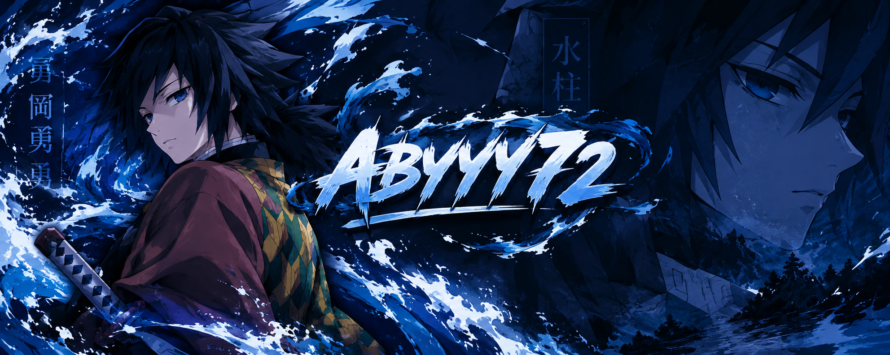

### IT Student

 

---

## ABOUT ME

> **Habiburrahman** — Informatics student who enjoys turning ideas into practical digital projects.

- 🎓 **Informatics Student** — Semester 5
- 💻 **Focus** — Web Development & Software Projects
- 🧠 **Learning** — Frontend, Backend, Database & APIs
- 🔧 **Tools** — Git, GitHub & VS Code
- 🌊 **Mindset** — Focus • Flow • Resolve

**Build quietly. Let the code speak.**

---

## 📊 GITHUB STATS

 

---

## 📈 COMMITS & ACTIVITY

---

## 🛠️ TECH STACK

  

**Currently exploring:** Web Development • REST API • Database • Full-Stack Development

---

## 🚀 WHAT I'M BUILDING

### 🧾 Strukify
Custom receipt generation for businesses that want receipts with their own identity and characteristics.

### 🛒 Cashier Project
A web-based cashier system focused on CRUD, database management, and transaction workflows.

### 🎮 MLBB Tournament
A tournament platform concept for managing teams, brackets, registration, and match information.

---

## 🎯 CURRENT DIRECTION

**Learn → Build → Test → Improve**

I'm focused on building real projects while strengthening my fundamentals in programming, web development, databases, and software engineering.

---

## 📬 CONNECT WITH ME

---

